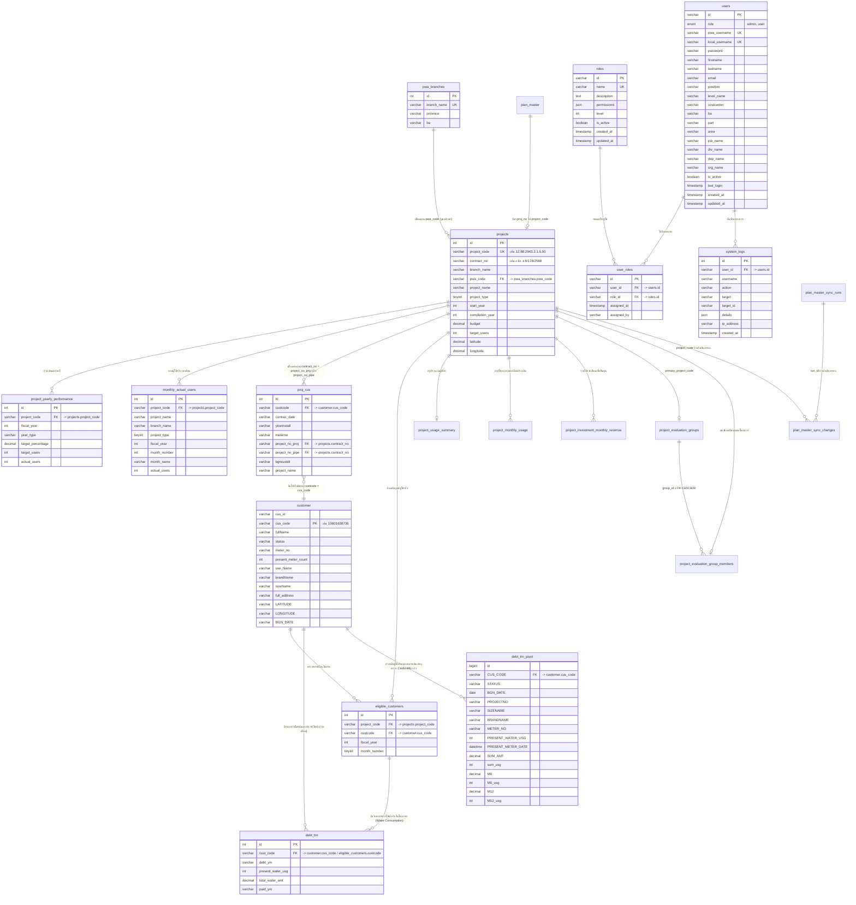
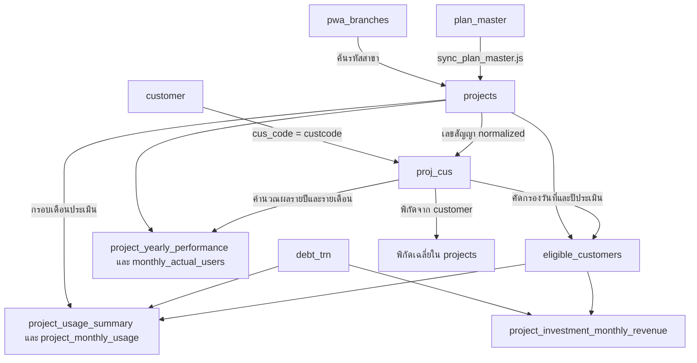

# รายละเอียดโครงสร้างตารางและความสัมพันธ์ของฐานข้อมูล (Database Schema & Relationships)

เอกสารนี้จัดทำขึ้นเพื่อบันทึกโครงสร้างฐานข้อมูล ความสัมพันธ์ของแต่ละตาราง และขั้นตอนการประมวลผลข้อมูลในระบบ เพื่อให้ผู้พัฒนาหรือผู้ดูแลระบบสามารถอ้างอิงและดำเนินการแก้ไขข้อมูลต่อได้ทันทีแม้ไม่ได้เชื่อมต่อกับผู้ช่วย AI

**ปรับปรุงล่าสุด: 16 ตุลาคม 2569 (2026-10-16)** — ตรวจเทียบกับโค้ดใน workspace โดยไม่ได้เชื่อมต่อฐานข้อมูลจริง ชนิดข้อมูลและข้อบังคับที่ระบุอ้างอิง DDL/migration ใน repository; ตารางดิบจาก PCIS และฐานข้อมูลที่ยังไม่ได้รัน migration อาจมีโครงสร้างต่างกัน ให้ตรวจด้วย `SHOW CREATE TABLE` เมื่อต้องยืนยันโครงสร้างที่ติดตั้งจริง

> เมื่อเปลี่ยนตาราง คอลัมน์ ชนิดข้อมูล คีย์ Index ความสัมพันธ์ แหล่งข้อมูล หรือกติกาประมวลผล ต้องอัปเดตเอกสารนี้พร้อมการแก้โค้ดทุกครั้ง รวมถึงแผนภาพ ผลกระทบต่อรายงาน และวิธีสร้างข้อมูลสรุปใหม่

---

## 1. ข้อมูลฐานข้อมูลทั่วไป (Database Configuration)
* **ชื่อฐานข้อมูล:** ใช้ค่า `DB_DATABASE` ใน environment ของ backend; `backend/db.js` บังคับให้กำหนดค่า ไม่มีชื่อฐานข้อมูลสำรอง เอกสารเดิมอ้างถึงทั้ง `pcis` และ `pwa6_expansion` จึงต้องตรวจค่าของ environment ที่ใช้งานจริง
* **ชุดรหัสอักขระ (Charset & Collation):** ตารางที่ระบบสร้างใช้ `utf8mb4` / `utf8mb4_unicode_ci`; ตารางดิบต้องตรวจความเข้ากันได้ของคอลัมน์ที่นำมา JOIN
* **ระบบจัดการฐานข้อมูลที่โปรเจกต์ระบุ:** MySQL 8.4; ไม่ควรถือว่า DDL ทุกส่วนใช้กับ MariaDB ได้โดยไม่ตรวจสอบ
* **การเริ่มต้น schema:** `backend/db.js` ทำงานเมื่อ `ENABLE_SCHEMA_INIT=true` และไม่ได้เปิด `SAFE_LOCAL_MODE`; การเชื่อมต่อปกติจึงไม่ได้สร้างตารางหรือรัน migration ทั้งหมดให้อัตโนมัติ

### 1.1. ตารางไหนเป็นตารางหลัก และตารางไหนนำข้อมูลไปใช้

| กลุ่ม | ตาราง | บทบาท |
|---|---|---|
| ข้อมูลหลักโครงการ | **`projects`** | ศูนย์กลางข้อมูลโครงการที่ API และรายงานนำไปใช้ |
| ข้อมูลหลักผู้ใช้น้ำ | **`customer`** | รายละเอียดผู้ใช้น้ำ ชื่อ ที่อยู่ วันที่เริ่มใช้น้ำ และพิกัด |
| ข้อมูลอ้างอิง | `pwa_branches` | สาขา จังหวัด เขต และรหัสองค์กร |
| ข้อมูลแผนต้นทาง | `plan_master` | ต้นทางสำหรับซิงก์รายละเอียดไปยัง `projects` |
| ตารางเชื่อม | `proj_cus` | ผูกผู้ใช้น้ำกับเลขสัญญาโครงการหลักหรือวางท่อเข้าซอย |
| รายการต้นทาง | `debt_trn` | บิล ปริมาณน้ำ และจำนวนเงินตามรอบเดือนของผู้ใช้น้ำ |
| ผลคัดกรอง | `eligible_customers` | คู่โครงการ–ผู้ใช้น้ำที่ผ่านกติกาประเมิน |
| ผลสรุปการติดตั้ง | `project_yearly_performance`, `monthly_actual_users` | ผลประเมินรายปีและจำนวนผู้ใช้น้ำรายเดือน |
| ผลสรุปการใช้น้ำ | `project_usage_summary`, `project_monthly_usage` | จำนวนผู้ใช้น้ำที่มีบิล และยอดใช้น้ำ/เงินในช่วงประเมิน |
| ผลสรุปคืนทุน | `project_investment_monthly_revenue` | ยอดรายเดือนสำหรับประเมินคืนทุน โดยไม่จำกัดเดือนบิลที่เพดานประเมิน 1/5 ปี |
| จัดกลุ่มประเมิน | `project_evaluation_groups`, `project_evaluation_group_members` | ระบุโครงการหลักและโครงการสมทบของกลุ่ม |
| บัญชีและสิทธิ์ | `users`, `roles`, `user_roles` | บัญชีผู้ใช้งานระบบและบทบาทการเข้าถึง |
| ประวัติ | `system_logs`, `import_history`, `plan_master_sync_runs`, `plan_master_sync_changes` | ประวัติกิจกรรม การนำเข้า และการซิงก์ |
| ตารางที่มีในเอกสารเดิม | `debt_trn_pivot` | ประวัติแบบ Pivot; ยังไม่พบการอ้างอิงใน `backend/server.js` ปัจจุบัน |

`project_code` คือรหัสโครงการสำหรับเชื่อมรายงาน ส่วน `contract_no` คือเลขสัญญาสำหรับจับคู่ข้อมูลติดตั้งจาก `proj_cus` ทั้งสองอย่างใช้แทนกันไม่ได้

---

## 2. โครงสร้างแต่ละตาราง (Table Definitions)

### 2.1. ตาราง `pwa_branches` (ตารางสาขาการประปาส่วนภูมิภาค)
ใช้เก็บรายชื่อสาขาและจังหวัดของ กปภ. **ทั้ง 10 เขต** (นำเข้าจากไฟล์ `pwa_office_all.xlsx`)
* **id** (`int`, Primary Key, Auto Increment): ไอดีประจำสาขา
* **branch_name** (`varchar(100)`, Unique): ชื่อสาขา เช่น `กปภ.สาขาขอนแก่น`, `กปภ.สาขานครราชสีมา`
* **province** (`varchar(100)`): จังหวัดที่สาขาตั้งอยู่ (ดึงจาก `pwa_address` อัตโนมัติ)
* **ba** (`varchar(10)`): รหัส Business Area ย่อย 4 หลัก (เช่น `1059` สำหรับขอนแก่น)
* **zone** (`tinyint`, Nullable): เขต กปภ. (1–10) ตามโครงสร้างองค์กรภูมิภาค
* **pwa_address** (`text`, Nullable): ที่อยู่สำนักงาน/สาขาเต็ม (ภาษาไทย)
* **longitude** (`decimal(10,6)`, Nullable): พิกัดลองจิจูดของสำนักงาน
* **latitude** (`decimal(10,6)`, Nullable): พิกัดละติจูดของสำนักงาน
* **pwa_code** (`varchar(20)`, Nullable): รหัส BA เต็ม 7 หลัก เช่น `5521000` สำหรับสำนักงานประปาเขต 6
* **pwa_station** (`int`, Nullable): ลำดับรหัสสำนักงานจากระบบ กปภ.

### 2.2. ตาราง `projects` (ตารางโครงการขยายเขต/วางท่อ)
เก็บข้อมูลรายละเอียดหัวโครงการหลักที่ดึงมาจากแผนแม่บทหรือป้อนเข้าใหม่
* **id** (`int`, Primary Key, Auto Increment): ไอดีแถว
* **project_code** (`varchar(50)`, Unique): รหัสโครงการหลัก (เช่น `1Z.68.2943.2.1.5.00`)
* **contract_no** (`varchar(100)`): เลขที่สัญญาของโครงการ (เช่น `กปภ.ข.6/178/2568` หรือ `กปภ.ข.6-01/2564`)
* **contract_no_normalized** (`varchar(100)`, STORED GENERATED): เลขสัญญาที่ตัดช่องว่างทั้งหมด โดยค่าว่างหรือ `"0"` กลายเป็น `NULL`; Unique Index `uq_projects_contract_no_normalized` ป้องกันเลขสัญญาจริงซ้ำ แต่อนุญาตหลายโครงการที่ยังไม่มีเลขสัญญา
* **branch_name** (`varchar(100)`): ชื่อสาขาที่รับผิดชอบโครงการ (ใช้สำหรับอ้างอิง)
* **pwa_code** (`varchar(20)`): รหัสสาขาที่ใช้เชื่อมต่อกับตาราง pwa_branches
* **project_name** (`varchar(255)`): ชื่อโครงการขยายเขต
* **project_type** (`tinyint`): ประเภทโครงการ
  * `1` = เงินรายได้ (เดิมคือ งบลงทุน)
  * `2` = เงินอุดหนุน (เดิมคือ งบอุดหนุน)
  * `3` = กระตุ้นเศรษฐกิจ (เดิมคือ งบกระตุ้นเศรษฐกิจ)
  * `4` = วางท่อเข้าซอย
  * `5` = งบประปาอาคาร(เพิ่มผู้ใช้น้ำ) — ประเมินสะสม 5 ปีเช่นเดียวกับประเภท 1
* **start_year** (`int`): ปีที่เริ่มโครงการ (พ.ศ.)
* **completion_year** (`int`): ปีงบประมาณที่แล้วเสร็จ (พ.ศ.); วันที่แล้วเสร็จเดือนตุลาคม–ธันวาคมใช้ปี พ.ศ. + 1 เมื่อไม่มีวันที่ให้ใช้ `start_year` ตามกติกาซิงก์
* **completed_date** (`varchar(100)`, Nullable): วันที่แล้วเสร็จ `DD/MM/YYYY` ปี พ.ศ.
* **budget** (`decimal(15,2)`): งบประมาณโครงการ
* **target_users** (`int`): เป้าหมายจำนวนผู้ใช้น้ำ (ราย)
* **latitude** (`decimal(10,7)`): พิกัดละติจูดของโครงการ (คำนวณจากค่าเฉลี่ยพิกัดผู้ใช้น้ำ)
* **longitude** (`decimal(10,7)`): พิกัดลองจิจูดของโครงการ (คำนวณจากค่าเฉลี่ยพิกัดผู้ใช้น้ำ)
* **remarks** (`varchar(500)`, Nullable): หมายเหตุโครงการ
* **created_date** / **updated_date** (`timestamp`): วันเวลาสร้าง/แก้ไขตาม DDL ใน `backend/seed.js`

### 2.3. ตาราง `project_yearly_performance` (ตารางเป้าหมายและผลสัมฤทธิ์รายปีสำหรับคำนวณสะสม)
เก็บเป้าหมายและผลจริงเป็นรายปี หนึ่งแถวต่อโครงการ–ปีงบประมาณ; DDL ใน `backend/seed.js` กำหนด Unique `(project_code, fiscal_year)` ตัวเลขในแต่ละแถวไม่ได้เป็นยอดสะสม ต้องรวมตามช่วงปีที่รายงานต้องการ
* **id** (`int`, Primary Key, Auto Increment): ไอดีแถว
* **project_code** (`varchar(50)`): รหัสโครงการ (เชื่อมไปยัง `projects.project_code`)
* **fiscal_year** (`int`): ปีงบประมาณการประเมิน (พ.ศ.)
* **year_type** (`varchar(20)`): ลำดับปีที่ประเมินโครงการ (`completion_year` (ปีที่แล้วเสร็จ), `year_1` (ปีที่ 1), `year_2`, `year_3`, `year_4`, `year_5_plus`)
* **target_percentage** (`decimal(5,2)`): สัดส่วนเป้าหมายที่จัดสรรให้ปีนั้น ไม่ใช่เปอร์เซ็นต์สะสม
  * *โครงการประเภท 1, 2, 3, 5:* ปีที่ 0 = 40%, ปีที่ 1 = 0%, ปีที่ 2-5 = ปีละ 15% รวม 100%
  * *โครงการประเภท 4:* ปีที่ 0 = 100%
* **target_users** (`int`): เป้าหมายเฉพาะปี คำนวณ `ROUND(projects.target_users × target_percentage / 100)`; การปัดเศษแต่ละปีอาจทำให้ผลรวมต่างจากเป้าหมายโครงการ
* **actual_users** (`int`): จำนวนผู้ใช้น้ำที่เกิดขึ้นจริงในปีงบประมาณนั้น (นับจำนวนการเชื่อมสายท่อจริง)

แม้ใช้ชื่อ `year_5_plus` โค้ดปัจจุบันนับเฉพาะปี `completion_year + 5` ไม่รวมผู้เริ่มใช้น้ำหลังปีที่ 5

### 2.4. ตาราง `monthly_actual_users` (ตารางรายงานผู้ใช้น้ำจริงแยกรายเดือน)
เก็บข้อมูลจำนวนผู้ใช้น้ำจริงที่เพิ่มขึ้นในแต่ละเดือนของโครงการแต่ละโครงการ
* **id** (`int`, Primary Key, Auto Increment): ไอดีแถว
* **project_code** (`varchar(50)`): รหัสโครงการ (เชื่อมไปยัง `projects.project_code`)
* **project_name** (`varchar(255)`): ชื่อโครงการ
* **branch_name** (`varchar(100)`): ชื่อสาขาที่ดูแล
* **project_type** (`tinyint`): ประเภทโครงการ (1, 2, 3, 4, 5)
* **fiscal_year** (`int`): ปีงบประมาณ (พ.ศ.)
* **month_number** (`tinyint`): ลำดับเดือนที่ผู้ใช้น้ำเกิด (1-12)
* **month_name** (`varchar(20)`): ชื่อย่อเดือนในภาษาไทย (เช่น 'ม.ค.', 'ก.พ.')
* **actual_users** (`int`): จำนวนผู้ใช้น้ำที่ลงทะเบียนเพิ่มขึ้นในเดือนและปีนั้น
* **early_users** (`int`, Default 0): จำนวนผู้ใช้น้ำก่อนโครงการแล้วเสร็จ แยกจากผลจริงที่ผ่านเกณฑ์

ระดับข้อมูลคือโครงการ–ปีงบประมาณ–เดือน โดย `month_number` เป็นเดือนปฏิทิน 1–12 แต่ปีงบประมาณเริ่มตุลาคม DDL ใน `seed.js` กำหนด Unique `(project_code, fiscal_year, month_number)` ส่วนกรณีสร้างผ่าน `update_data.js` ใช้ `project_name TEXT`, `month_name VARCHAR(50)` และไม่ได้ประกาศ Unique นี้ จึงต้องยืนยัน schema ที่ติดตั้งจริง

### 2.5. ตาราง `customer` (ตารางโปรไฟล์หลักของผู้ใช้น้ำจากระบบ PCIS)
เก็บรายละเอียดข้อมูลส่วนบุคคลและข้อมูลผู้ใช้น้ำ
* **cus_id** (`varchar(20)`): รหัส ID ภายใน
* **cus_code** (`varchar(20)`, Index): รหัสผู้ใช้น้ำประจำตัว (เช่น `10601638736`)
* **fullName** (`varchar(100)`): ชื่อ-นามสกุลของผู้ใช้น้ำ
* **status** (`varchar(1)`): สถานะมาตรวัดน้ำ
* **meter_no** (`varchar(50)`): หมายเลขมาตรวัดน้ำ
* **present_meter_count** (`int`): ตัวเลขการใช้มาตรน้ำปัจจุบัน
* **use_Name** (`varchar(500)`): ประเภท/ลักษณะการใช้น้ำ
* **brandName** (`varchar(50)`): ยี่ห้อมาตรวัด
* **sizeName** (`varchar(10)`): ขนาดมาตรวัดน้ำ (เช่น 1/2 นิ้ว)
* **full_address** (`varchar(500)`): ที่อยู่เต็มของผู้ใช้น้ำ
* **LATITUDE** (`varchar(20)`): พิกัดจุดผู้ใช้น้ำ (ละติจูด)
* **LONGITUDE** (`varchar(20)`): พิกัดจุดผู้ใช้น้ำ (ลองจิจูด)
* **BGN_DATE** (`varchar(50)` / `date`): วันที่เริ่มต้นติดตั้งและใช้น้ำจริง (ปี ค.ศ.)

### 2.6. ตาราง `proj_cus` (ตารางจับคู่ระหว่างผู้ใช้น้ำกับสัญญาโครงการ)
เชื่อมโยงรหัสผู้ใช้น้ำแต่ละคนว่าเกิดขึ้นจากสัญญาโครงการตัวใด
* **Id** (`int`, Primary Key, Auto Increment): ไอดีแถว
* **custcode** (`varchar(50)`): รหัสผู้ใช้น้ำ (เชื่อมกับ `customer.cus_code`)
* **contrac_date** (`varchar(10)`): วันที่เซ็นสัญญาติดตั้งมาตรวัด (ในรูปแบบ ดด/ปป/ปปปป)
* **yearinstall** (`varchar(5)`): ปีงบประมาณที่เข้าติดตั้ง (พ.ศ.)
* **meterno** (`varchar(20)`): เลขมาตรวัดน้ำ
* **project_no_proj** (`varchar(100)`): เลขที่สัญญาของโครงการหลักที่ผู้ใช้น้ำติดตั้ง (เชื่อมกับ `projects.contract_no`)
* **project_no_pipe** (`varchar(100)`): เลขที่สัญญาโครงการวางท่อเข้าซอย (เชื่อมกับ `projects.contract_no` เพิ่มเติม)
* **project_no_proj_normalized** (`varchar(100)`, STORED GENERATED INVISIBLE): เลขสัญญาโครงการหลักที่ตัดช่องว่างทั้งหมดแล้ว โดย `""`/`"0"` เป็น `NULL`
* **project_no_pipe_normalized** (`varchar(100)`, STORED GENERATED INVISIBLE): เลขสัญญาวางท่อที่ตัดช่องว่างทั้งหมดแล้ว โดย `""`/`"0"` เป็น `NULL`
* **bgncustdt** (`varchar(6)`): วันที่ติดตั้งใช้น้ำสะสมในรูปแบบตัวเลข YYMMDD (เช่น 671015 เป็นข้อมูลสำรอง)
* **project_name** (`varchar(500)`): ชื่อโครงการขยายเขต

Indexes สำหรับค้นหาลูกค้าตามเลขสัญญา:
* `idx_proj_cus_proj_norm_cust (project_no_proj_normalized, custcode)`
* `idx_proj_cus_pipe_norm_cust (project_no_pipe_normalized, custcode)`

### 2.7. ตาราง `plan_master` (ตารางแม่แบบการนำเข้าแผนงานหลัก)
ตารางแผนต้นทาง ใช้ `backend/utils/planMasterSync.js` แปลงข้อมูลแล้วสร้างหรืออัปเดต `projects` ตามรหัสโครงการ ไม่ใช่ View และไม่ซิงก์ทุกครั้งที่ SELECT

| คอลัมน์ต้นทาง | คอลัมน์ปลายทางใน `projects` | การแปลง |
|---|---|---|
| `proj_no` | `project_code` | รหัสที่ใช้จับคู่โครงการ |
| `contract_no` | `contract_no` | ตัดช่องว่าง; `0` เป็นค่าว่าง |
| `branch` | `branch_name`, `pwa_code` | เก็บชื่อ และค้นรหัสจาก `pwa_branches` |
| `proj_name` | `project_name` | ชื่อโครงการ |
| `type_proj` | `project_type` | รองรับ 1–5 |
| `proj_year` | `start_year` | ปี พ.ศ. |
| `completed_date` | `completed_date`, `completion_year` | แปลงเป็นปีงบประมาณที่แล้วเสร็จ |
| `budget`, `target` | `budget`, `target_users` | แปลงเป็นตัวเลข |
| `remarks` | `remarks` | หมายเหตุ |

คอลัมน์อื่นที่ API เพิ่ม/นำเข้าโครงการใช้งาน ได้แก่ `ba`, `wwcode`, `contract_no_gis`, `proj_name_gis` ชนิดข้อมูลของตารางดิบต้องยืนยันจากฐานข้อมูลจริง การเพิ่ม/แก้โครงการผ่าน API บางเส้นทางเขียนกลับ `plan_master` ด้วย จึงไม่ควรถือว่าข้อมูลไหลทางเดียวทุกกรณี

### 2.8. ตาราง `eligible_customers` (ตารางสรุปรายชื่อผู้ใช้น้ำที่ผ่านเกณฑ์ของโครงการ)
ใช้เก็บรายชื่อผู้ใช้น้ำจริงที่ผ่านเกณฑ์การประเมินเพื่อนำไปแสดงผลและวิเคราะห์ประสิทธิภาพ
* **id** (`int`, Primary Key, Auto Increment): ไอดีแถว
* **project_code** (`varchar(50)`): รหัสโครงการหลัก (เชื่อมไปยัง `projects.project_code`)
* **custcode** (`varchar(50)`): รหัสผู้ใช้น้ำ (เชื่อมไปยัง `customer.cus_code`)
* **fiscal_year** (`int`): ปีงบประมาณที่เข้าใช้น้ำจริง (พ.ศ.)
* **month_number** (`tinyint`): ลำดับเดือนที่เกิดยอดการติดตั้งใช้น้ำจริง (1-12)

Unique `(project_code, custcode)` ป้องกันผู้ใช้น้ำซ้ำภายในโครงการเดียวกัน ตารางนี้สร้างใหม่จาก `projects` + `proj_cus` + `customer`; ผู้ใช้น้ำก่อนแล้วเสร็จ (`early_users`), วันที่อนาคต และผู้เริ่มใช้น้ำนอกช่วงประเมินไม่ถูกเพิ่มเข้ามา ประเภท 4 ใช้ปีที่แล้วเสร็จ ส่วนประเภท 1, 2, 3, 5 ใช้ปีที่แล้วเสร็จถึงปีที่ +5 การมีชื่อใน `proj_cus` จึงไม่ได้หมายความว่าจะผ่านเกณฑ์เสมอ

### 2.9. ตาราง `users` (ตารางข้อมูลผู้ใช้งานระบบ)
ใช้เก็บข้อมูลและประวัติการเข้าใช้งานของบุคลากรภายในระบบ
* **id** (`varchar(36)`, Primary Key): ไอดีผู้ใช้งาน (UUID)
* **role** (`enum('admin', 'user')`): บทบาทสิทธิ์หลักของระบบงาน
* **pwa_username** (`varchar(100)`): ชื่อเข้าใช้งานระบบแบบบูรณาการของ กปภ. (AD/PWA)
* **local_username** (`varchar(100)`): ชื่อเข้าใช้งานระบบแบบทั่วไป
* **password** (`varchar(255)`): รหัสผ่านที่เข้ารหัสความปลอดภัย (bcrypt)
* **firstname** / **lastname** (`varchar(100)`): ชื่อ-นามสกุลจริง
* **email** / **position** (`varchar(255)`): อีเมลและตำแหน่งงาน
* **level_name** / **costcenter** (`varchar(100)`): ระดับตำแหน่งและรหัสศูนย์ต้นทุน
* **ba** (`varchar(20)`): รหัส Business Area (BA)
* **part** / **area** (`varchar(100)`): ส่วนงาน/สาขาที่รับผิดชอบ
* **job_name** / **div_name** / **dep_name** / **org_name** (`varchar(255)`): ชื่อตำแหน่งงานย่อย ฝ่าย แผนก และองค์กร
* **is_active** (`boolean`): สถานะการเปิดใช้งานบัญชี
* **last_login** (`timestamp`): วันเวลาเข้าสู่ระบบล่าสุด
* **created_at** / **updated_at** (`timestamp`): วันเวลาสร้างและแก้ไขข้อมูลล่าสุด

### 2.10. ตาราง `roles` (ตารางบทบาทหน้าที่และสิทธิ์การเข้าถึง)
ใช้ระบุขอบเขตและระดับการเข้าใช้งานคุณสมบัติต่าง ๆ
* **id** (`varchar(36)`, Primary Key): ไอดีบทบาท (UUID)
* **name** (`varchar(100)`): ชื่อบทบาท (เช่น `admin`, `user`)
* **description** (`text`): รายละเอียดหน้าที่ของสิทธิ์
* **permissions** (`json`): รายการสิทธิ์การทำงานย่อย (เช่นการจัดการข้อมูลดิบ)
* **level** (`int`): ลำดับความสำคัญในการทำงานระบบ
* **is_active** (`boolean`): สถานะการเปิดสิทธิ์ทำงาน
* **created_at** / **updated_at** (`timestamp`): วันเวลาบันทึกและแก้ไขระบบ

### 2.11. ตาราง `user_roles` (ตารางเชื่อมโยงสิทธิ์การใช้งานของผู้ใช้)
เชื่อมโยงเพื่อจัดสรรสิทธิ์ตามระบบงานรายบุคคล
* **id** (`varchar(36)`, Primary Key): ไอดีแถว (UUID)
* **user_id** (`varchar(36)`): รหัสผู้ใช้งาน (เชื่อมไปยัง `users.id`)
* **role_id** (`varchar(36)`): รหัสบทบาทใช้งาน (เชื่อมไปยัง `roles.id`)
* **assigned_at** (`timestamp`): วันเวลาจัดตั้งสิทธิ์
* **assigned_by** (`varchar(36)`): ไอดีของผู้ใช้ที่เป็นคนมอบหมายสิทธิ์

### 2.12. ตาราง `system_logs` (ตารางประวัติกิจกรรมและ Log การเข้าใช้งาน)
บันทึกประวัติการกระทำเพื่อความปลอดภัยและการตรวจสอบระบบย้อนหลัง
* **id** (`int`, Primary Key, Auto Increment): ไอดี Log
* **user_id** (`varchar(36)`): ไอดีของผู้ทำกิจกรรม (เชื่อมไปยัง `users.id`)
* **username** (`varchar(100)`): ชื่อผู้ใช้งานที่เข้าระบบขณะนั้น
* **action** (`varchar(50)`): กิจกรรมที่ทำ (เช่น `LOGIN`, `UPDATE_PROJECT`)
* **target** / **target_id** (`varchar(50)` / `varchar(100)`): ตาราง/เป้าหมาย และไอดีของเป้าหมายที่ถูกกระทำ
* **details** (`json`): รายละเอียดการทำงานเพิ่มเติม
* **ip_address** (`varchar(45)`): หมายเลขไอพีของผู้ใช้งาน
* **created_at** (`timestamp`): วันเวลาบันทึก Log กิจกรรม

### 2.13. ตาราง `debt_trn` (ตารางบันทึกการใช้น้ำและหนี้ค้างชำระรายเดือนของผู้ใช้น้ำจากระบบ PCIS)
ใช้เก็บรายละเอียดประวัติการใช้น้ำและบิลค่าน้ำรายเดือนของลูกค้าแต่ละราย
* **id** (`int`, Primary Key): ไอดีอ้างอิงของหนี้
* **cust_code** (`varchar(50)`): รหัสผู้ใช้น้ำ (เชื่อมกับ `customer.cus_code` หรือ `eligible_customers.custcode`)
* **debt_ym** (`varchar(20)`): ปีและเดือนที่บันทึกบิล/หนี้ ในรูปแบบ พ.ศ. (เช่น 256812 สำหรับเดือนธันวาคม 2568)
* **present_water_usg** (`int`): ปริมาณน้ำประปาที่ใช้งานจริงในรอบบิลนั้น (ลูกบาศก์เมตร)
* **total_water_amt** (`decimal(18,6)`): จำนวนเงินค่าน้ำค้างชำระในรอบบิล (บาท)
* **paid_ym** (`varchar(20)`): ปีและเดือนที่มีการชำระเงินค่าหนี้นั้น

Composite index สำหรับรายละเอียดการใช้น้ำตามลูกค้าและช่วงเดือน:
* `idx_debt_trn_cust_code_debt_ym (cust_code, debt_ym)`

### 2.14. ตาราง `debt_trn_pivot` (ตาราง Pivot สรุปประวัติปริมาณการใช้น้ำและยอดเงินสะสม)
**สถานะการใช้งาน:** เก็บรายละเอียดเดิมไว้เพื่ออ้างอิง ยังไม่พบการอ่านตารางนี้ใน `backend/server.js` หรือการสร้างใหม่ใน `backend/update_data.js` จึงไม่ยืนยันว่าเป็นแหล่งข้อมูลของรายงานปัจจุบัน หรือมีความสัมพันธ์ 1:1 กับผู้ใช้น้ำจริง

ตารางโครงสร้างพิเศษที่ทำการสรุปยอดใช้น้ำและยอดบิลสะสมย้อนหลังแยกรายเดือน (M0 ถึง M12) สำหรับวิเคราะห์แนวโน้มลูกค้าแต่ละราย
* **id** (`bigint`): ไอดีอ้างอิง
* **CUS_CODE** (`varchar(20)`): รหัสผู้ใช้น้ำประจำตัว (เชื่อมกับ `customer.cus_code`)
* **STATUS** (`varchar(5)`): สถานะมาตรปัจจุบัน
* **BGN_DATE** (`date`): วันที่เริ่มต้นใช้น้ำจากการประปา
* **PROJECTNO** (`varchar(200)`): รหัสสัญญาโครงการที่ผู้ใช้น้ำสังกัด
* **SIZENAME** / **BRANDNAME** / **METER_NO** (`varchar`): ขนาดมาตร ยี่ห้อ และเลขมาตรวัดน้ำ
* **PRESENT_WATER_USG** / **PRESENT_METER_DATE**: เลขมาตรและวันเวลาที่บันทึกหน่วยล่าสุด
* **SUM_AMT** (`decimal(18,6)`): ยอดเงินค่าน้ำค้างชำระรวมสะสมทั้งหมด
* **sum_usg** (`int`): ปริมาณการใช้น้ำสะสมรวมทั้งหมด
* **M0** ถึง **M12** (`decimal(18,6)`): ยอดเงินค้างชำระย้อนหลังแยกรายเดือน (M0 = เดือนปัจจุบัน, M1 ย้อนหลัง 1 เดือน...)
* **M0_usg** ถึง **M12_usg** (`int`): ปริมาณน้ำที่ใช้ย้อนหลังแยกรายเดือน (M0_usg = เดือนปัจจุบัน, M1_usg ย้อนหลัง 1 เดือน...)

---

### 2.15. ตาราง `project_usage_summary` (สรุปผู้ใช้น้ำที่มีบิล)

หนึ่งแถวต่อโครงการ สร้างจาก `projects` + `eligible_customers` + `debt_trn`

| คอลัมน์ | ชนิด/ข้อบังคับ | ความหมาย |
|---|---|---|
| `project_code` | `varchar(50)` PK | รหัสโครงการ |
| `total_users` | `int NOT NULL DEFAULT 0` | `COUNT(DISTINCT debt_trn.cust_code)` ภายในช่วงเดือนประเมิน |

จำนวนนี้อาจต่างจากจำนวนใน `eligible_customers` เพราะผู้ผ่านเกณฑ์บางรายยังไม่มีบิลในช่วงที่นำมาสรุป

### 2.16. ตาราง `project_monthly_usage` (สรุปการใช้น้ำรายโครงการ–เดือน)

สร้างจาก `projects` + `eligible_customers` + `debt_trn` ใช้ใน `/api/water-usage/summary`

| คอลัมน์ | ชนิด/ข้อบังคับ | ความหมาย |
|---|---|---|
| `project_code` | `varchar(50) NOT NULL` | รหัสโครงการ |
| `debt_ym` | `varchar(6) NOT NULL` | เดือนบิล `YYYYMM` ปี พ.ศ. เช่น `256910` |
| `total_bills` | `int NOT NULL DEFAULT 0` | จำนวนแถวบิล `COUNT(debt_trn.id)` |
| `total_usage` | `int NOT NULL DEFAULT 0` | ผลรวม `present_water_usg` |
| `total_amount` | `decimal(12,2) NOT NULL DEFAULT 0` | ผลรวม `total_water_amt` |

Unique `uq_project_ym (project_code, debt_ym)`; Index `idx_project (project_code)`, `idx_debt_ym (debt_ym)`

เดือนบิลที่นำมารวม: ประเภท 4 ตั้งแต่ตุลาคมของ `completion_year - 1` ถึงกันยายนของ `completion_year`; ประเภท 1, 2, 3, 5 ถึงกันยายนของ `completion_year + 5`

### 2.17. ตาราง `project_investment_monthly_revenue` (สรุปรายได้สำหรับวิเคราะห์คืนทุน)

สร้างจาก `eligible_customers` + `debt_trn` ใช้ใน `/api/investment-breakeven/summary` และรายละเอียดกลุ่มประเมิน

| คอลัมน์ | ชนิด/ข้อบังคับ | ความหมาย |
|---|---|---|
| `project_code` | `varchar(50) NOT NULL` | รหัสโครงการ |
| `debt_ym` | `varchar(6) NOT NULL` | เดือนบิล ปี พ.ศ. |
| `total_usage` | `bigint NOT NULL DEFAULT 0` | ผลรวมปริมาณน้ำ |
| `total_amount` | `decimal(18,2) NOT NULL DEFAULT 0` | ผลรวมจำนวนเงินจากรายการบิล |

PK `(project_code, debt_ym)`; Index `idx_investment_revenue_month (debt_ym)` อ้างอิง `backend/migrate_investment_revenue_summary.js` และ `backend/update_data.js`

เก็บทุกเดือนบิลของผู้ใช้น้ำใน `eligible_customers` ไม่ตัดเดือนบิลที่เพดานประเมิน 1/5 ปี แล้ว API กรองตามเดือนเริ่มจำหน่ายน้ำของโครงการอีกครั้ง แต่รายชื่อผู้ใช้น้ำยังผ่านกติกา `eligible_customers` อยู่ จำนวนเงินเป็นยอดจาก `total_water_amt` ไม่ใช่หลักฐานการรับชำระเงินจริงหรือกำไรสุทธิหลังหักต้นทุน

### 2.18. ตาราง `project_evaluation_groups` (หัวกลุ่มประเมิน)

| คอลัมน์ | ชนิด/ข้อบังคับ | ความหมาย |
|---|---|---|
| `id` | `bigint unsigned` PK Auto Increment | รหัสกลุ่ม |
| `primary_project_code` | `varchar(50) NOT NULL` Unique | โครงการหลักของกลุ่ม อ้างอิงเชิงตรรกะไปยัง `projects.project_code` |
| `group_name` | `varchar(255)` Nullable | ชื่อกลุ่ม |
| `created_by` | `varchar(36)` Nullable | ผู้สร้าง อ้างอิงเชิงตรรกะไปยัง `users.id` |
| `created_at`, `updated_at` | `datetime` | เวลาสร้างและแก้ไข |

### 2.19. ตาราง `project_evaluation_group_members` (สมาชิกกลุ่มประเมิน)

| คอลัมน์ | ชนิด/ข้อบังคับ | ความหมาย |
|---|---|---|
| `id` | `bigint unsigned` PK Auto Increment | รหัสสมาชิก |
| `group_id` | `bigint unsigned NOT NULL` FK | เชื่อม `project_evaluation_groups.id` พร้อม `ON DELETE CASCADE` |
| `project_code` | `varchar(50) NOT NULL` Unique | โครงการสมาชิก; หนึ่งโครงการอยู่ได้หนึ่งกลุ่ม |
| `member_role` | `enum('primary','contributor') NOT NULL` | โครงการหลักหรือโครงการสมทบ |
| `relationship_reason` | `varchar(100)` Nullable | เหตุผลการเชื่อมโยง |
| `note` | `varchar(500)` Nullable | หมายเหตุ |
| `created_by` | `varchar(36)` Nullable | ผู้สร้างรายการ |
| `created_at` | `datetime` | เวลาสร้าง |

มี Unique `(group_id, project_code)` และ Index `(group_id)` เพิ่มเติม ข้อบังคับ FK ที่ยืนยันได้จาก `backend/db.js` และ `backend/migrate_project_evaluation_links.js` คือสมาชิก → หัวกลุ่ม ส่วนการอ้างรหัสโครงการ/ผู้สร้างใน DDL นี้ไม่ได้ประกาศ FK

### 2.20. ตาราง `import_history` (ประวัตินำเข้า)

DDL อยู่ใน `backend/db.js`: `id INT` PK Auto Increment, `user_id INT`, `user_role VARCHAR(50)`, `user_zone INT`, `file_name VARCHAR(255)`, `total_records INT`, `imported_records INT`, `skipped_records INT`, `created_at DATETIME DEFAULT CURRENT_TIMESTAMP`

เก็บผู้ดำเนินการ ไฟล์ จำนวนรายการที่นำเข้าและข้าม **ข้อสังเกต:** `user_id` ใน DDL นี้เป็น `INT` ต่างจาก `users.id` ที่เอกสารระบุเป็น UUID `VARCHAR(36)` และไม่ได้ประกาศ FK จึงยังไม่ควรถือว่าเชื่อมแบบมีข้อบังคับได้

### 2.21. ตาราง `plan_master_sync_runs` (ประวัติรอบซิงก์)

DDL อยู่ใน `backend/utils/planMasterSync.js`: `id CHAR(36)` PK, `started_at DATETIME`, `completed_at DATETIME NULL`, `status VARCHAR(20) NOT NULL`, `details JSON NULL` และตัวนับ `INT NOT NULL DEFAULT 0` ได้แก่ `source_rows`, `inserted_rows`, `updated_rows`, `unchanged_rows`, `skipped_rows`, `conflict_rows`

ใช้ติดตามผลแต่ละรอบที่ซิงก์แผนไปยัง `projects`

### 2.22. ตาราง `plan_master_sync_changes` (รายละเอียดการเปลี่ยนจากการซิงก์)

DDL อยู่ใน `backend/utils/planMasterSync.js`: `id BIGINT` PK Auto Increment, `run_id CHAR(36) NOT NULL`, `project_code VARCHAR(50) NOT NULL`, `change_type VARCHAR(20) NOT NULL`, `changed_fields JSON NULL`, `created_at DATETIME DEFAULT CURRENT_TIMESTAMP`

Index `(run_id)` และ `(project_code)` เชื่อมเชิงตรรกะกับ `plan_master_sync_runs.id` และ `projects.project_code` โดย DDL ไม่ได้ประกาศ FK

---

## 3. แผนภาพความสัมพันธ์และการเชื่อมต่อข้อมูล (Database Entity Relationships)

แผนภาพนี้แสดงความสัมพันธ์เชิงตรรกะสำหรับการอ่านและประมวลผล คำว่า `FK` ในภาพหมายถึงคอลัมน์อ้างอิง ไม่ได้ยืนยันว่าฐานข้อมูลติดตั้ง Foreign Key จริงทุกเส้น ตารางดิบอาจมีข้อมูลซ้ำหรือไม่มีข้อมูลคู่กัน; โดยเฉพาะ `debt_trn_pivot` ยังไม่ยืนยัน Cardinality



### 3.1. เส้นทางการประมวลผลข้อมูล



`proj_cus` บอกความเกี่ยวข้องกับสัญญา ส่วน `eligible_customers` เป็นผลคัดกรอง ผู้เริ่มใช้น้ำก่อนแล้วเสร็จถูกแยกเป็น `early_users` ไม่รวมในรายชื่อผ่านเกณฑ์ และข้อมูลรายปี/รายเดือนถูกคำนวณจากข้อมูลติดตั้งชุดเดียวกัน ไม่ได้ SELECT จาก `eligible_customers` โดยตรง

---

## 4. ข้อสังเกตเชิงลึกเกี่ยวกับการดึงข้อมูล (Queries and Joins)

### 4.1. การดึงข้อมูลผู้ใช้น้ำของแต่ละโครงการ
การทำงานของ API Endpoint: `/api/project-customers/:project_code`
ระบบจับคู่เลขสัญญาที่ normalized แล้วทั้ง `project_no_proj_normalized` และ `project_no_pipe_normalized` ด้วย `UNION` จากนั้นดึงรายละเอียดจาก `customer` และประเมินวันที่ในโค้ด ตัวอย่าง SQL ต่อไปนี้แสดงเฉพาะส่วนเชื่อมข้อมูล ไม่ใช่เงื่อนไขทั้งหมดของ API:

```sql
SELECT 
  pc.custcode AS cus_code, 
  COALESCE(c.fullName, 'ไม่พบรายชื่อในฐานข้อมูล') AS fullName, 
  c.LATITUDE, 
  c.LONGITUDE, 
  COALESCE(c.full_address, 'ไม่พบที่อยู่ในฐานข้อมูล') AS full_address,
  COALESCE(c.meter_no, pc.meterno) AS meter_no,
  COALESCE(c.use_Name, '-') AS use_Name,
  COALESCE(c.brandName, '-') AS brandName,
  COALESCE(c.sizeName, '-') AS sizeName,
  COALESCE(c.present_meter_count, 0) AS present_meter_count,
  COALESCE(c.status, '-') AS status
FROM (
  SELECT pc.custcode, pc.meterno
  FROM projects p
  JOIN proj_cus pc ON pc.project_no_proj_normalized = p.contract_no_normalized
  WHERE p.project_code = ? AND p.contract_no_normalized IS NOT NULL
  UNION
  SELECT pc.custcode, pc.meterno
  FROM projects p
  JOIN proj_cus pc ON pc.project_no_pipe_normalized = p.contract_no_normalized
  WHERE p.project_code = ? AND p.contract_no_normalized IS NOT NULL
) pc
LEFT JOIN customer c ON c.cus_code = pc.custcode;
```

---

## 5. การจัดการปัญหาข้อมูลไม่แสดงผล (Data Inconsistency / Missing Users)

### 5.1. ปัญหารายชื่อผู้ใช้น้ำในสัญญาปี 2568 ไม่แสดงผล
ตัวเลขและรหัสต่อไปนี้เป็นกรณีตัวอย่างจากการตรวจในอดีต ไม่ใช่ผลตรวจฐานข้อมูลล่าสุด

* **สาเหตุ:** ข้อมูลผู้ใช้น้ำรายใหม่ ๆ ได้ถูกบันทึกลงในตาราง `proj_cus` แล้วเพื่อเชื่อมโยงกับโครงการ (เช่น โครงการสัญญา 178/2568 มีจำนวน 93 ราย) แต่รายชื่อและที่อยู่ของผู้ใช้น้ำเหล่านั้น**ยังไม่ได้เพิ่มเข้าไปในตาราง `customer`** 
* **จุดสังเกต:**
  * ข้อมูลรหัสผู้ใช้น้ำล่าสุดในตาราง `customer` สิ้นสุดอยู่ที่ `10601638437`
  * แต่ข้อมูลผู้ใช้น้ำของโครงการในปี 2568 ในตาราง `proj_cus` มีรหัสวิ่งไปจนถึง `10601646966`
  * รหัสที่หายไปทั้งหมด (เช่น `10601638736` หรือรหัสที่สูงกว่า `10601638437`) จะแสดงผลเป็น **"ไม่พบรายชื่อในฐานข้อมูล"**

### 5.2. แนวทางการแก้ไขเมื่อได้รับข้อมูลอัปเดต
เมื่อได้รับตารางผู้ใช้น้ำล่าสุดจากระบบ PCIS (เช่น ไฟล์ SQL Dump ตาราง `customer` ล่าสุด):
1. นำข้อมูลไปอัปเดตลงตาราง `customer` โดยการ Import ไฟล์ SQL เพิ่มเติม หรือดำเนินการผ่านคำสั่ง SQL INSERT/REPLACE เพื่อนำรหัสผู้ใช้น้ำที่ขาดหายเข้าไปในระบบ
2. หลังจากนำเข้าแล้ว ให้ทำการรันสคริปต์คำนวณพิกัดโครงการและผลการดำเนินงานใหม่ โดยรันคำสั่ง:
   ```bash
   cd backend
   node update_data.js
   ```
   *หมายเหตุ: คำสั่งนี้จะทำการดึงพิกัดเฉลี่ยของผู้ใช้น้ำแต่ละรายที่อยู่ในโครงการนั้น ๆ มาอัปเดตลงฟิลด์ `latitude` และ `longitude` ของตาราง `projects` ใหม่อัตโนมัติ พร้อมอัปเดตตัวเลขผลสัมฤทธิ์ในตารางประสิทธิภาพ*

---

## 6. ลำดับการประมวลผลและการอัปเดตระบบหากมีการเปลี่ยนแปลงโครงสร้าง
1. เมื่อเปลี่ยนตาราง/คอลัมน์/Index/ข้อบังคับ ให้ตรวจ DDL ที่เกี่ยวข้องใน `backend/seed.js`, `backend/db.js`, `backend/migrate*.js`, `backend/update_data.js` และ `backend/utils/planMasterSync.js` พร้อมจัดทำ migration สำหรับฐานข้อมูลเดิม การแก้ `CREATE TABLE IF NOT EXISTS` อย่างเดียวไม่เปลี่ยนตารางที่มีอยู่แล้ว
2. ตัวแปรสภาพแวดล้อมที่ตั้งค่าสำหรับการเชื่อมโยงฐานข้อมูลหลักจะกำหนดอยู่ในไฟล์ `backend/.env` ในหัวข้อ:
   * `DB_HOST`
   * `DB_PORT`
   * `DB_USER`
   * `DB_PASSWORD`
   * `DB_DATABASE` (ต้องกำหนดให้ตรงกับ environment ที่ใช้งาน)
3. อัปเดต `DATABASE_SCHEMA.md` ในชุดการแก้ไขเดียวกัน ครอบคลุมหน้าที่ตาราง ระดับข้อมูลต่อแถว ชนิดข้อมูล/Null/Default/PK/Unique/FK/Index ความสัมพันธ์ แหล่งข้อมูล เงื่อนไขคำนวณ รายงานที่ได้รับผล และขั้นตอนประมวลผลใหม่ พร้อมวันที่และขอบเขตการตรวจสอบ
4. ตรวจความสอดคล้องกับ API ที่อ่าน/เขียนข้อมูลและวิธีติดตั้งจริง อย่าระบุว่ามี FK หรือ Unique หากพบเพียง JOIN ในโค้ด และอย่าระบุว่าตรวจฐานข้อมูลจริงหากตรวจเฉพาะไฟล์

### 6.1. ลำดับอัปเดตข้อมูลปกติ

หลังนำเข้าข้อมูลต้นทางครบแล้ว ให้รันจากโฟลเดอร์ `backend` ตามลำดับ:

```bash
npm run sync:plan-master:dry-run
npm run sync:plan-master
node update_data.js
```

คำสั่งซิงก์แรกแสดงผลที่จะเปลี่ยน คำสั่งที่สองซิงก์จริงโดยบันทึกประวัติ; หากพบรหัสโครงการหรือเลขสัญญาขัดแย้ง ให้แก้ต้นทางก่อนดำเนินต่อ การซิงก์นี้ใช้ `pwa_branches` ค้นรหัสสาขา ไม่ได้สร้างรายชื่อสาขาใหม่

`update_data.js` ล้างแล้วสร้างข้อมูลใหม่ใน `eligible_customers`, `project_yearly_performance`, `monthly_actual_users`, `project_usage_summary`, `project_monthly_usage`, `project_investment_monthly_revenue` พร้อมคำนวณพิกัดใน `projects` จึงเป็นคำสั่งเขียนข้อมูล ไม่ใช่คำสั่งตรวจสอบ และต้องรอให้ประมวลผลสำเร็จก่อนใช้ผลสรุป

โค้ดตัวตั้งเวลาใน `backend/server.js` ระบุเวลา 02:00 และเรียก `sync_plan_master.js --apply` ต่อด้วย `update_data.js`; ต้องตรวจการเปิดใช้งานและเขตเวลาของ process ที่ติดตั้งจริง ส่วน host cron ให้ตรวจคำสั่งใน `backend/cron_update_metrics.sh` และไม่ควรเปิดสองตัวตั้งเวลาซ้ำกัน การคำนวณมี MySQL named lock ป้องกัน `update_data.js` ซ้อนกัน

`SAFE_LOCAL_MODE=true` บล็อกสคริปต์เขียนข้อมูล ห้ามใช้ `migrate.js` แทนงานอัปเดตประจำวัน เพราะเป็นเส้นทางย้ายข้อมูลเต็มที่รีเซ็ตโครงการ/สาขา

---

## 7. ผลกระทบเมื่อมีการอัปเดตข้อมูลในตารางดิบ (Data Update Impacts)

ในระบบนี้มีตารางกลุ่มที่เป็นข้อมูลดิบ (Raw Data) ซึ่งถ้านำเข้าหรืออัปเดตข้อมูลใหม่ จะส่งผลกระทบต่อเนื่องไปยังตารางแสดงผลอื่นๆ (Dashboard Tables) โดยมีรายละเอียดดังนี้:

### 7.1. ตาราง `plan_master` (ตารางแผนงานหลัก)
ตารางนี้เป็นหัวใจหลักของข้อมูลโครงการทั้งหมด หากอัปเดตจะส่งผลกระทบต่อ:
* **ตาราง `projects`**: ข้อมูลรายละเอียดโครงการ เช่น ชื่อโครงการ, งบประมาณ, เป้าหมายผู้ใช้น้ำ (Target), ประเภทโครงการ, ปีที่เริ่มและแล้วเสร็จ จะถูกนำข้อมูลใหม่ไปสร้างหรืออัปเดต
* **ตาราง `pwa_branches`**: การซิงก์ปกติอ่านเพื่อค้นรหัสสาขา ไม่ได้อัปเดตตาม `plan_master` อัตโนมัติ หากเพิ่มสาขาต้องนำเข้าหรือปรับข้อมูลอ้างอิงแยกต่างหาก
* การเปลี่ยนข้อมูลใน `plan_master` ด้วย SQL จะยังไม่เปลี่ยน `projects` จนกว่าจะซิงก์ และ `update_data.js` อย่างเดียวไม่ได้ซิงก์แผนให้

### 7.2. ตาราง `proj_cus` (ตารางเชื่อมผู้ใช้น้ำเข้ากับสัญญาโครงการ)
หากมีการอัปเดตตารางนี้ (เช่น นำเข้าประวัติการติดตั้งใหม่) จะส่งผลกระทบต่อ:
* **ตาราง `project_yearly_performance`**: ยอดผู้ใช้น้ำจริงเฉพาะปี (`actual_users`) จะถูกคำนวณใหม่ตามปีงบประมาณที่มีการติดตั้ง และรายงานจึงนำไปคำนวณสะสม
* **ตาราง `monthly_actual_users`**: ยอดผู้ใช้น้ำจริงรายเดือนจะถูกแยกเดือนและปีใหม่
* **ตาราง `projects` (พิกัด)**: ทำให้จุดกึ่งกลางของโครงการบนแผนที่เปลี่ยนไป เพราะโครงการจะอ้างอิงพิกัดเฉลี่ยของผู้ใช้น้ำตามที่ผูกไว้ในตารางนี้

### 7.3. ตาราง `customer` (ตารางโปรไฟล์ผู้ใช้น้ำ)
หากมีการอัปเดตข้อมูล (เช่น การเพิ่มผู้ใช้ใหม่, แก้ไขพิกัดละติจูด/ลองจิจูด) จะส่งผลกระทบต่อ:
* **ตาราง `projects`**: จุดศูนย์กลางบนแผนที่ของโครงการต่างๆ จะแม่นยำขึ้น หากผู้ใช้น้ำแต่ละรายมีข้อมูล LATITUDE และ LONGITUDE ที่ถูกต้อง
* **หน้าแสดงรายชื่อผู้ใช้น้ำของแต่ละโครงการ**: ข้อมูลจะแสดงผลแบบ Real-time ทันทีผ่าน API ผู้ใช้น้ำที่เคยขึ้นว่า *"ไม่พบรายชื่อในฐานข้อมูล"* ก็จะแสดงรายละเอียดชื่อ-สกุลและพิกัดได้ถูกต้อง

### 7.4. ตาราง `debt_trn` และแหล่งข้อมูลของรายงาน

| API / ข้อมูล | แหล่งข้อมูลสำคัญ | ผลเมื่ออัปเดต `debt_trn` โดยตรง |
|---|---|---|
| `/api/water-usage/summary` | `project_usage_summary`, `project_monthly_usage`, `projects` | ต้องสร้างตารางสรุปใหม่ |
| `/api/investment-breakeven/summary` | `project_investment_monthly_revenue`, `projects` | ต้องสร้างตารางรายได้ใหม่ |
| `/api/water-usage/customers` | `eligible_customers`, `customer`, `debt_trn` | รายการบิลใหม่อ่านได้เมื่อเรียก API แต่รายชื่อผ่านเกณฑ์ยังอิงผลประมวลผลเดิม |
| `/api/project-customers-water-usage/:project_code` | `eligible_customers`, `customer`, `debt_trn` | รายการบิลใหม่อ่านได้เมื่อเรียก API แต่การเป็นสมาชิกโครงการยังอิงผลประมวลผลเดิม |

เมื่อเพิ่มบิล ต้องรัน `node update_data.js` เพื่อให้รายงานภาพรวมและคืนทุนสอดคล้องกับรายละเอียด หากเพิ่ม/เปลี่ยนผู้ใช้น้ำด้วย ให้รอ `customer` และ `proj_cus` นำเข้าครบก่อนประมวลผล ส่วน `debt_trn_pivot` ยังไม่พบว่าเป็นแหล่งข้อมูล API เหล่านี้ในโค้ดปัจจุบัน

### 7.5. เปลี่ยนประเภทโครงการผ่านหน้าเว็บ

ผู้ใช้ที่มีสิทธิ์แก้ไขโครงการและเข้าถึงเขตของโครงการ สามารถกดปุ่มแก้ไขข้างเลขที่สัญญาในตารางโครงการ เปิดหน้าต่าง **แก้ไขข้อมูลโครงการ** แล้วเลือก **ประเภทโครงการ** 1–5 และบันทึก เช่น ค้นสัญญา `กปภ.ข.6/72/2568` แล้วเลือกประเภท 5 — งบประปาอาคาร(เพิ่มผู้ใช้น้ำ)

`PUT /api/projects/:project_code/contract` รับ `project_type` เป็นตัวเลขหรือข้อความตัวเลข 1–5; หากไม่ส่งจะคงประเภทเดิม บันทึก `projects.project_type` และ `plan_master.type_proj` ภายใน Transaction เดียวกัน เพื่อป้องกันค่าถูกย้อนกลับจากการซิงก์รอบถัดไป และบันทึกประเภทก่อน/หลังไว้ใน `system_logs` โดยไม่ได้เพิ่มคอลัมน์ฐานข้อมูล

API คำนวณเฉพาะโครงการที่แก้ใหม่ทันที ได้แก่ `eligible_customers`, `project_yearly_performance`, `monthly_actual_users` (รวม `early_users`), `project_usage_summary`, `project_monthly_usage` และ `project_investment_monthly_revenue` หากการคำนวณหรือการบันทึกล้มเหลวจะ Rollback ทั้งชุด จึงไม่ต้องรัน `update_data.js` ทั้งระบบสำหรับการแก้ผ่านหน้าต่างนี้

กติกาวันเริ่มใช้น้ำใช้ `customer.BGN_DATE` ก่อน `proj_cus.bgncustdt` ตัดวันที่อนาคต แยกผู้เริ่มใช้น้ำก่อน/ตรงวันแล้วเสร็จเป็น `early_users` และไม่นับรหัสผู้ใช้น้ำซ้ำภายในโครงการ ประเภท 4 คัดผู้ผ่านเกณฑ์เฉพาะปีงบประมาณแล้วเสร็จ ส่วนประเภท 1, 2, 3, 5 คัดถึงปีที่ +5 พร้อมสร้างเป้าหมายรายปีตามประเภทใหม่

การเพิ่มโครงการและการนำเข้าผ่าน API อื่นต้องตรวจขอบเขตการสร้างสรุปของแต่ละเส้นทางแยกต่างหาก การนำเข้าข้อมูลต้นทางโดยตรงยังต้องประมวลผลตามหัวข้อ 6.1

---

## 8. ปัญหา Collation Mismatch และแนวทางการแก้ไข (Collation Mismatch Issues)

### 8.1. สาเหตุของปัญหา
เนื่องจากโครงสร้างฐานข้อมูลประกอบด้วย **ตารางใหม่ที่ใช้แสดงผล (Dashboard Tables)** เช่น `projects`, `eligible_customers`, `users` และ **ตารางดิบจากระบบ กปภ. (PCIS Raw Tables)** ที่นำเข้าจากภายนอก เช่น `customer`, `proj_cus`, `debt_trn`
* ตารางดิบเหล่านี้อาจมีชุดรหัสอักขระ (Charset) หรือการเปรียบเทียบคำ (Collation) ดั้งเดิมเป็นค่าอื่น เช่น `latin1_swedish_ci` หรือ `utf8_general_ci`
* ตารางหลักของระบบและตารางประสิทธิภาพสร้างขึ้นด้วย `utf8mb4_unicode_ci` เพื่อความถูกต้องในภาษาไทยและอิโมจิ
* เมื่อระบบ API หรือสคริปต์พยายามเปรียบเทียบรหัสผู้ใช้ผ่านคำสั่ง Join (เช่น `customer.cus_code = proj_cus.custcode`) จะเกิดข้อผิดพลาดของ MySQL:
  > **`ERROR 1267 (HY000): Illegal mix of collations (utf8mb4_unicode_ci, COERCIBLE) for operation '='`**

### 8.2. แนวทางการแก้ไข

#### วิธีที่ 1: การใช้คำสั่งแปลงระดับคิวรี SQL (Query-level Fix)
เมื่อคอลัมน์ต้นทางมี Charset/Collation ต่างกัน อาจใช้ `CONVERT` และ `COLLATE` เพื่อแก้เฉพาะคิวรีได้ ตัวอย่างต่อไปนี้เป็นแนวทางรองรับโครงสร้างเดิม ไม่ใช่รูปแบบ JOIN หลักของโค้ดปัจจุบันที่ใช้คอลัมน์ normalized และ Index:
```sql
SELECT * FROM proj_cus pc
LEFT JOIN customer c ON CONVERT(pc.custcode USING utf8mb4) COLLATE utf8mb4_unicode_ci = c.cus_code
JOIN projects p ON TRIM(CONVERT(pc.project_no_proj USING utf8mb4)) COLLATE utf8mb4_unicode_ci = TRIM(p.contract_no)
```

#### วิธีที่ 2: การปรับแก้ไขชุดอักขระถาวรที่ฐานข้อมูล (Database-level Alter Fix)
เพื่อประสิทธิภาพสูงสุดในการทำงานและคิวรีที่รวดเร็ว (ไม่ต้องให้ฐานข้อมูลแปลงรหัสระหว่างคิวรี) ให้ปรับ Collation ของคอลัมน์สำคัญที่ต้อง Join กันโดยตรง โดยในโฟลเดอร์ `backend/` มีสคริปต์แก้ปัญหาเตรียมไว้แล้ว สามารถเรียกใช้ได้ทันที:

1. **ปรับปรุงความสอดคล้องคอลัมน์ในตารางหนี้ค้างชำระ (`debt_trn`):**
   ```bash
   node fix_collation.js
   ```
   *(ทำการปรับโครงสร้างคอลัมน์ `cust_code` และ `debt_ym` ของตาราง `debt_trn` ให้ใช้ `utf8mb4_unicode_ci` ตรงกับระบบหลัก)*

2. **ปรับปรุงความสอดคล้องคอลัมน์รหัสโครงการและรหัสเชื่อมสัญญาท่อ (`projects`):**
   ```bash
   node fix_projects_collation.js
   ```
   *(ทำการปรับโครงสร้างคอลัมน์ `projects.project_code` เพื่อป้องกันปัญหากับตารางอื่นๆ)*

